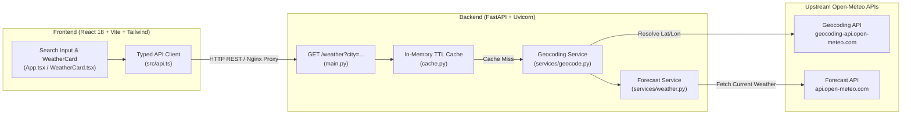

# Weather-Now (`multi-weather-app`)


**Weather-Now** is a full-stack, containerized weather application featuring a **FastAPI** backend proxy with TTL caching and a **React + TypeScript + Tailwind CSS** frontend. It queries the free [Open-Meteo API](https://open-meteo.com/) (requiring zero API keys out of the box) while abstracting geocoding and weather providers behind clean backend service interfaces.

---

## 🎯 Use Case & Problem Statement

Frontend-only weather apps often expose third-party API keys in browser network traffic, suffer from rate-limiting on repeated city lookups, and tightly couple UI components to a single weather vendor's JSON schema.

**Weather-Now solves this with a production-ready full-stack blueprint:**
- **Provider-Agnostic Backend Proxy:** The FastAPI backend normalizes city geocoding (`geocode.py`) and weather forecasting (`weather.py`) into a clean REST contract (`GET /weather?city=<name>`), making it trivial to swap between Open-Meteo, OpenWeatherMap, or WeatherAPI without touching the React UI.
- **In-Memory TTL Caching:** Caches responses per city (`cache.py`) to minimize upstream latency and prevent rate-limit exhaustion.
- **Turnkey DevOps & Quality Gates:** Ships with multi-service Docker Compose orchestration, Nginx production serving, `Makefile` automation, pre-commit hooks (`ruff`, `black`, `isort`, `prettier`), and GitHub Actions CI for both Python and Node.js.

---

## 🏗️ System Architecture



---

## 📁 Project Structure

```text
multi-weather-app/
├── .github/workflows/ci.yml               # GitHub Actions CI (Backend ruff/black/isort/pytest + Frontend lint/vitest/build)
└── multi-weather-app/
    ├── backend/
    │   ├── main.py                        # FastAPI application & /weather route
    │   ├── cache.py                       # TTL cache layer for city weather lookups
    │   ├── services/
    │   │   ├── geocode.py                 # City-to-coordinates resolution via Open-Meteo Geocoding
    │   │   └── weather.py                 # Current weather fetcher & response normalizer
    │   ├── tests/
    │   │   └── test_main.py               # Pytest suite with mocked upstream API responses
    │   ├── requirements.txt               # Python dependencies
    │   └── Dockerfile                     # Backend container image definition
    ├── frontend/
    │   ├── src/
    │   │   ├── App.tsx                    # Main weather search & display view
    │   │   ├── api.ts                     # Backend REST client
    │   │   └── components/
    │   │       ├── WeatherCard.tsx        # Weather telemetry card
    │   │       ├── WeatherCard.test.tsx   # Vitest + React Testing Library suite
    │   │       └── SkeletonCard.tsx       # Loading state skeleton UI
    │   ├── tailwind.config.js             # Tailwind CSS configuration
    │   ├── vite.config.ts                 # Vite bundler config
    │   └── Dockerfile                     # Multi-stage frontend build + Nginx image
    ├── docker-compose.yml                 # Full-stack local & production container orchestration
    ├── Makefile                           # Developer shortcut commands
    └── nginx.conf                         # Nginx reverse-proxy configuration
```

---

## 🚀 Prerequisites & Setup

### Prerequisites
- **Docker & Docker Compose** (for containerized single-command startup), *or*:
- **Python `3.11+`** and **Node.js `20+`** (for local native development)

### Installation (Native Local Setup)

```bash
# 1. Clone the repository
git clone https://github.com/gmanojkumar2000/multi-weather-app.git
cd multi-weather-app/multi-weather-app

# 2. Install Backend dependencies
cd backend
python -m venv .venv
source .venv/bin/activate  # Windows PowerShell: .\.venv\Scripts\Activate.ps1
pip install -r requirements.txt

# 3. Install Frontend dependencies
cd ../frontend
npm ci
```

---

## 💻 How to Run & Test

### Option A: Run with Docker Compose (Recommended)
```bash
cd multi-weather-app
docker compose up --build
```
- **Frontend UI:** `http://localhost:5173`
- **Backend API & Swagger Docs:** `http://localhost:8000/docs`

### Option B: Run Locally in Development Mode
```bash
# Terminal 1 — Start FastAPI Backend (port 8000)
cd multi-weather-app/backend
uvicorn main:app --reload --port 8000

# Terminal 2 — Start React Vite Frontend (port 5173)
cd multi-weather-app/frontend
npm run dev
```

### Run Automated Tests & Linters
```bash
# Backend Linting & Unit Tests
cd multi-weather-app/backend
python -m ruff check .
python -m black --check .
python -m isort --check-only .
python -m pytest

# Frontend Linting, Unit Tests & Build Verification
cd ../frontend
npm run lint
npm test -- --run
npm run build
```
